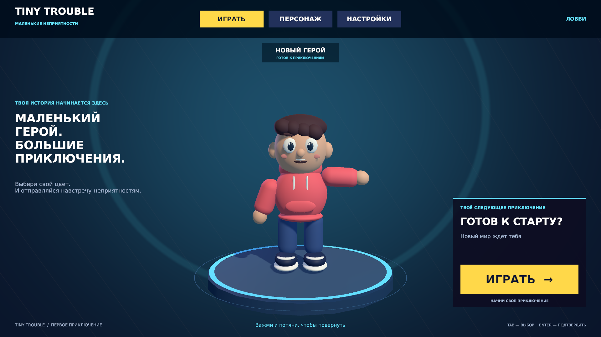
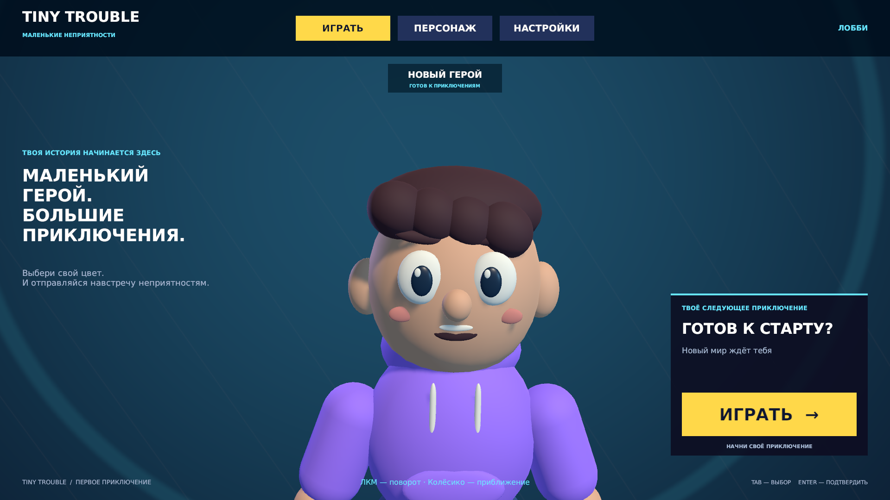
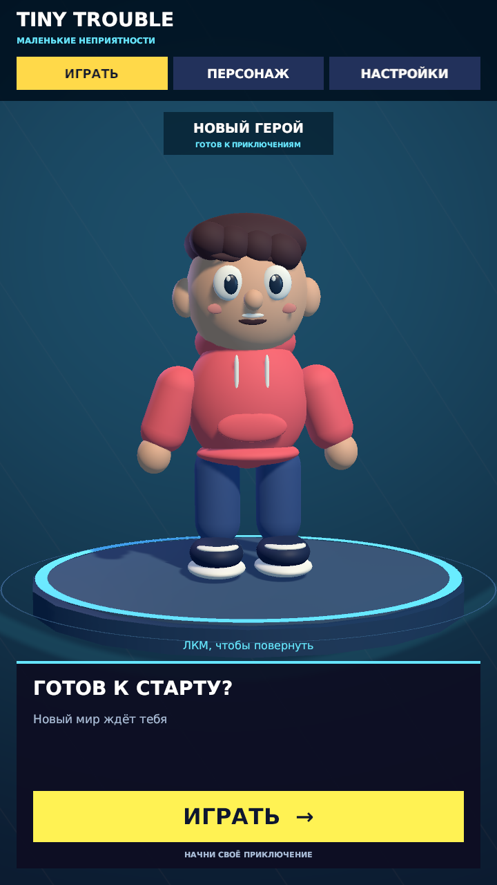

# Tiny Trouble

**Tiny Trouble — «Маленькие неприятности»** — проект собственной игры на Unity
с мультяшным человечком. Сейчас готово стартовое 3D-лобби: герой стоит на
подсвеченной платформе, а вокруг него расположены вкладки и большая кнопка «Играть».



## Что уже готово

- Лобби с синим фоном, освещением и лёгким покачиванием персонажа.
- Дыхание, моргание, однократное приветствие и три случайных жеста героя.
- Взгляд на мышь и реакция на новый цвет толстовки; вращение прерывает крупные жесты.
- Вращение героя мышью на полный круг во всех вкладках лобби.
- Плавное приближение и отдаление героя колёсиком мыши, включая крупный план лица и одежды.
- Вкладки «Играть», «Персонаж» и «Настройки».
- Автоматическая раскладка для горизонтального, вертикального и квадратного окна:
  вкладки, выбранная панель и герой занимают отдельные области.
- Четыре цвета толстовки: жёлтый, голубой, красный и фиолетовый.
- Настройка общей громкости от 0 до 100%.
- Сохранение цвета и громкости между запусками.
- Управление меню мышью и клавиатурой, поддержка русских надписей.
- Редактируемая сцена и отдельный prefab персонажа — сохранённый шаблон героя.

## Статус разработки

Проект находится на этапе разработки меню. **Игрового уровня пока нет:**
кнопка «Играть» открывает `SampleScene`, где сейчас есть только камера и свет.
Для возвращения в лобби нужно остановить режим игры и снова открыть сцену `Lobby`.

Движение игрока, бои, сетевые матчи и другие игровые механики ещё не реализованы.
Их состав будет определяться в следующих задачах.

Согласован макет магазина и инвентаря с восемью категориями косметики
и валютой «Шалкоины». Требования к переносу в Unity записаны в
[спецификации магазина](docs/superpowers/specs/2026-10-11-shop-inventory-design.md).
Магазин пока не реализован в игровой сцене; существующие проверки ниже
относятся к нынешнему лобби.

Адаптивное лобби проверялось в редакторе на 13 размерах, включая 1920×1080,
1280×720, 1024×768, 1024×1024, 720×1280 и 390×844. Отдельная сборка игры,
работа на мобильном устройстве, сенсорный ввод и вырезы экрана пока не проверялись.

## Как запустить

### Что понадобится

- Unity Hub — приложение для установки Unity и открытия проектов.
- **Unity Editor 2022.3.62f3** — версия редактора, указанная в проекте.
- Git — программа для скачивания проекта и сохранения истории изменений.
  Он также нужен Unity для получения пакета MCP for Unity из Git-репозитория.
- Доступ к интернету при первом открытии для загрузки зависимостей.

### Первое открытие

1. Скачайте проект. Например, выполните в терминале:

   ```bash
   git clone https://github.com/denisx555/Tiny-Trouble.git
   ```

   Если проект уже скачан, используйте существующую папку.
2. В Unity Hub установите Unity **2022.3.62f3**, если этой версии ещё нет.
3. Добавьте папку проекта в список проектов Unity Hub. Выбирайте папку,
   внутри которой находятся `Assets`, `Packages` и `ProjectSettings`.
4. Откройте проект и дождитесь загрузки пакетов, импорта файлов и компиляции кода.
5. В панели **Project** откройте `Assets/Scenes/Lobby.unity` двойным щелчком.
6. Нажмите **Play** в верхней части редактора. Это включает Play Mode — режим игры.
   Меню появится во вкладке **Game**.

Открывайте только один экземпляр Unity с этим проектом. Если он уже открыт,
переключитесь на существующее окно. Перед перезапуском сохраните изменения,
закройте редактор и дождитесь его завершения.

## Как пользоваться меню

| Элемент | Что делает |
| --- | --- |
| Вкладка «Играть» | Показывает главную панель с кнопкой запуска. |
| Большая кнопка «Играть» | Загружает пока пустую `SampleScene`. |
| Вкладка «Персонаж» | Позволяет выбрать цвет толстовки; выбор сразу сохраняется. |
| Вкладка «Настройки» | Меняет общую громкость и сохраняет её значение. |
| Левая кнопка мыши на герое + движение влево / вправо | Поворачивает персонажа вокруг вертикальной оси. |
| Колёсико над персонажем | Вверх — приблизить лицо и одежду, вниз — отдалить. |
| Tab / Shift+Tab | Переводит выделение на следующий / предыдущий доступный элемент. |
| Стрелки | Перемещают выделение; на выбранном ползунке меняют громкость. |
| Enter | Нажимает выбранную кнопку. |

Настройки хранятся на компьютере игрока через **PlayerPrefs** — встроенное
хранилище небольших значений Unity. При первом запуске выбраны жёлтая толстовка
и громкость 100%. Музыка в текущую версию ещё не добавлена.
Процент громкости в меню отображается с пробелом, например `37 %`.

Чтобы рассмотреть героя, зажмите левую кнопку мыши на его модели и потяните
влево или вправо. После отпускания выбранный поворот остаётся, покачивание
продолжается. При новом запуске лобби герой снова смотрит вперёд; угол поворота
не записывается в настройки. Перетаскивание ползунка громкости не вращает героя.

Наведите указатель на персонажа и прокрутите колёсико. Камера плавно приближается
и при крупном плане направляется на лицо и грудь; ноги могут уходить за экран.
Расстояние ограничено, чтобы камера не проходила внутрь модели.
Над кнопками и ползунком колёсико не меняет приближение. Выбранный крупный план
сохраняется при смене вкладок и размеров окна, а при новом входе в лобби
возвращается обычный вид. Размер элементов меню от приближения не меняется.



Герой дышит и моргает, один раз машет при входе в лобби, а затем делает
небольшой случайный жест через 5–10 секунд после предыдущего. Один и тот же
жест не повторяется подряд. Глаза и голова слегка следят за мышью, когда
герой повёрнут к камере; при вращении слежение плавно прекращается.

Вдох и выдох занимают 3 секунды: верх тела немного поднимается и опускается,
а толстовка заметно расширяется и сужается. Движение продолжается при вращении;
ступни остаются на платформе.

При выборе нового цвета герой смотрит на толстовку и кивает; реакция занимает
1,6 секунды. Повторный выбор того же цвета и восстановление настройки при
запуске не вызывают кивка. Вращение мышью плавно прерывает крупные жесты,
а дыхание и моргание продолжаются. При нескольких быстрых сменах цвета
остаётся только последняя реакция. Нажатие на машущую руку также начинает вращение.
Точки поворота плеч находятся внутри туловища: рукав сохраняет соединение
с телом при взмахе и приветствии. Перенос точек не меняет исходный вид героя.

При изменении размера окна меню перестраивается автоматически. На широком
экране описание находится слева, а выбранная панель — справа. На вертикальном
и квадратном экране панель занимает нижнюю часть, а герой остаётся над ней.
В промежуточном горизонтальном формате, например 4:3, герой расположен слева,
панель — справа, а вкладки — отдельной строкой под названием игры.
На узком экране длинное описание и подсказки клавиатуры скрываются.
Камера подбирает расстояние с учётом всех жестов, поэтому не приближается
и не отдаляется при каждом взмахе. Имя героя располагается выше модели.



## Устройство проекта

| Путь | Назначение |
| --- | --- |
| `Assets/Scenes/Lobby.unity` | Стартовая сцена с героем, платформой и интерфейсом. |
| `Assets/Scenes/SampleScene.unity` | Пустая сцена, которую открывает кнопка «Играть». |
| `Assets/TinyTrouble/Runtime/` | C#-код, работающий во время игры. |
| `Assets/TinyTrouble/Editor/` | Инструмент создания лобби для редактора Unity. |
| `Assets/TinyTrouble/Prefabs/` | Шаблон персонажа. |
| `Assets/TinyTrouble/Materials/` | Материалы — настройки цвета и внешнего вида объектов. |
| `Assets/TinyTrouble/Meshes/` | Сохранённая геометрия колец платформы. |
| `Assets/TinyTrouble/UI/` | Шрифты и shader — правило рисования фона. |
| `Assets/TinyTrouble/Tests/` | Автоматические проверки настроек, сцены и меню. |
| `Assets/Plugins/Roslyn/` | Библиотеки выполнения C#-кода для инструментов Unity MCP. |
| `Packages/` | Список зависимостей и закреплённые версии пакетов. |
| `ProjectSettings/` | Настройки Unity, включая версию редактора и порядок сцен. |
| `docs/` | Описание лобби, план работы, отчёт проверки и изображения. |

Основные скрипты:

- [LobbyController.cs](Assets/TinyTrouble/Runtime/LobbyController.cs) переключает
  панели, применяет настройки и запускает следующую сцену.
- [LobbyLayout.cs](Assets/TinyTrouble/Runtime/LobbyLayout.cs) переставляет элементы
  меню и подстраивает камеру при изменении размера окна.
- [LobbyPreferences.cs](Assets/TinyTrouble/Runtime/LobbyPreferences.cs) читает,
  проверяет и сохраняет громкость и цвет.
- [CharacterIdle.cs](Assets/TinyTrouble/Runtime/CharacterIdle.cs) объединяет
  покачивание героя с выбранным углом поворота.
- [CharacterDrag.cs](Assets/TinyTrouble/Runtime/CharacterDrag.cs) обрабатывает
  перетаскивание левой кнопкой мыши и прокрутку колёсика над персонажем. Камера с `PhysicsRaycaster`
  находит объёмные области нажатия героя и его рук (`BoxCollider`) и передаёт события
  через ту же систему, которая управляет меню.
- [CharacterLife.cs](Assets/TinyTrouble/Runtime/CharacterLife.cs) выбирает жесты,
  отсчитывает паузы и согласует реакции с вращением и сменой цвета.
- [CharacterGestures.cs](Assets/TinyTrouble/Runtime/CharacterGestures.cs) двигает
  группы тела, рук и ног, добавляет дыхание и хранит границы всех поз.
- [CharacterFace.cs](Assets/TinyTrouble/Runtime/CharacterFace.cs) управляет
  морганием, взглядом, оглядыванием и кивком головы.
- [CharacterRigBuilder.cs](Assets/TinyTrouble/Editor/CharacterRigBuilder.cs)
  подготавливает группы частей и измеряет границы движений в редакторе.
- [LobbySceneBuilder.cs](Assets/TinyTrouble/Editor/LobbySceneBuilder.cs) создаёт
  сцену командой **Tiny Trouble → Build Lobby**. Для обычного запуска эта команда
  не нужна: лобби уже сохранено. Повторное создание может заменить ручные правки
  сцены и персонажа.

Интерфейс использует **uGUI** — кнопки, текст и панели поверх 3D-сцены.
Графика использует **Built-in Render Pipeline** — встроенный способ рисования Unity.
В **File → Build Settings** сцены идут в порядке `Lobby`, затем `SampleScene`.

## Инструменты разработки

Unity загружает зависимости по [Packages/manifest.json](Packages/manifest.json).
Закреплённые версии, включая вложенные зависимости, находятся в
[Packages/packages-lock.json](Packages/packages-lock.json).

| Пакет | Версия в проекте | Назначение |
| --- | --- | --- |
| uGUI | 1.0.0 | Интерфейс лобби. |
| Unity Test Framework | 1.1.33 | Запуск автоматических тестов. |
| MCP for Unity | 10.3.0 | Связь помощника с редактором Unity. |
| Cinemachine | 3.1.7 | Инструменты управления камерами. |
| ProBuilder | 5.2.4 | Создание и редактирование геометрии в редакторе. |
| VFX Graph | 14.0.12 | Создание визуальных эффектов. |
| glTFast | 6.14.1 | Загрузка моделей формата glTF/GLB. |

Наличие пакета в проекте не означает, что лобби уже использует все его возможности.

**Unity MCP** позволяет помощнику работать со сценами, объектами и консолью
редактора. Для такой работы нужен запущенный MCP-сервер и настроенное подключение
в приложении помощника. Для ручного открытия проекта и проверки меню подключать
помощника не требуется.

## Проверка работы

### Проверка вручную

1. Запустите `Lobby` и переключите все три вкладки.
2. Выберите каждый цвет: должна меняться только толстовка.
3. Установите громкость 0, 37 и 100 процентов: надпись рядом должна показывать
   `0 %`, `37 %` и `100 %` соответственно.
4. Остановите Play Mode и запустите его снова: цвет и громкость должны сохраниться.
5. Проверьте Tab, Shift+Tab, стрелки и Enter.
6. Нажмите «Играть»: должна открыться `SampleScene` без ошибок в **Console** —
   окне сообщений редактора.
7. Снова запустите `Lobby`. Во всех вкладках зажмите левую кнопку на герое
   и потяните в обе стороны. Он должен вращаться и сохранять выбранный угол
   после отпускания. Правой кнопкой и движением вверх / вниз он не вращается.
8. Перетащите ползунок громкости: герой не должен поворачиваться. При новом
   запуске лобби его поза должна вернуться к исходной.
9. В списке размеров вкладки **Game** выберите горизонтальный, вертикальный
   и квадратный вариант, затем снова горизонтальный. Переключите все вкладки:
   название, кнопки, надписи и герой не должны перекрывать друг друга.
10. При новом запуске герой один раз машет. Подождите: видны дыхание,
    моргание и случайные жесты с паузами 5–10 секунд. Вкладки не повторяют приветствие.
11. Подвигайте мышь вокруг героя, затем поверните его боком и спиной:
    слежение должно прекратиться. Во время вращения глаза продолжают моргать.
12. Выберите другой цвет: толстовка меняется сразу, герой смотрит вниз и кивает.
    Повторите тот же цвет — нового кивка не будет. Быстро смените несколько цветов
    и начните вращение за машущую кисть: старые реакции не должны накапливаться.
13. Наведите мышь на героя и прокрутите колёсико в обе стороны. Приближение
    плавное и ограниченное; при крупном плане можно рассмотреть лицо и толстовку.
    Прокрутка над кнопками и ползунком не двигает камеру. Смена вкладок и размера
    окна сохраняет приближение; новый запуск лобби возвращает обычный вид.

### Автоматические тесты

Сначала сохраните сцены и выйдите из Play Mode. Откройте
**Window → General → Test Runner** — окно запуска тестов Unity.

- Во вкладке **EditMode** нажмите **Run All**: проверяются сохранённая сцена,
  ссылки на её объекты, группы героя, границы поз и обработка настроек.
- Во вкладке **PlayMode** нажмите **Run All**: проверяются вкладки, цвета,
  громкость, управление, жесты, моргание, взгляд, вращение и приближение героя, изменение размеров лобби и переход
  в `SampleScene` во время игры. Проверка раскладки временно добавляет размеры
  в Game View и после завершения возвращает исходный вариант.

После добавления приближения прошли **21/21 EditMode** и **56/56 PlayMode**;
результаты записаны в [отчёте приближения](docs/superpowers/reports/2026-10-10-zoom-validation.md).
Предыдущий запуск — в [отчёте дыхания](docs/superpowers/reports/2026-10-10-breathing-validation.md).
Проверка соединения плеча также проходит с новым дыханием; прежний запуск —
в [отчёте исправления плеча](docs/superpowers/reports/2026-10-10-shoulder-validation.md).
Предыдущий запуск сохранён в [отчёте живого героя](docs/superpowers/reports/2026-10-10-character-life-validation.md).
Проверка раскладки
охватывает все три вкладки на 13 размерах, четыре поворота героя и все крупные
жесты в разных фазах. Результаты относятся к указанному запуску; после изменений
кода проверки нужно повторять. Предыдущие результаты адаптивного лобби сохранены
в [раннем отчёте](docs/superpowers/reports/2026-10-10-lobby-validation.md).

## Документация и правила работы

- [Описание лобби](docs/superpowers/specs/2026-10-10-lobby-design.md) — согласованный
  вид, поведение и требования к первой версии.
- [Живой персонаж](docs/superpowers/specs/2026-10-10-character-life-design.md) —
  описание реализованных жестов, моргания и реакций в лобби.
- [План живого персонажа](docs/superpowers/plans/2026-10-10-character-life.md) —
  этапы реализации, проверки и учебный шаг с паузой между жестами.
- [План реализации](docs/superpowers/plans/2026-10-10-lobby.md) — этапы работы
  и учебное задание.
- [Отчёт проверки](docs/superpowers/reports/2026-10-10-lobby-validation.md) —
  результаты тестов и известные ограничения на дату проверки.
- [Проверка живого героя](docs/superpowers/reports/2026-10-10-character-life-validation.md) —
  движения, реакции, новые снимки и результаты итогового запуска тестов.
- [Исправление плеча](docs/superpowers/reports/2026-10-10-shoulder-validation.md) —
  устранение зазора при взмахе, новые проверки и учебная правка высоты плеча.
- [AGENTS.md](AGENTS.md) — правила для помощника и работы с проектом.
- [Заметность дыхания](docs/superpowers/reports/2026-10-10-breathing-validation.md) —
  усиление движения тела, проверки и учебная правка высоты вдоха.
- [Приближение колёсиком](docs/superpowers/reports/2026-10-10-zoom-validation.md) —
  крупный план, сохранение приближения и проверки управления камерой.

Комментарии в C# пишутся по-русски. Перед объявлениями используются
XML-комментарии документации (`/// <summary>` и другие подходящие теги).
Обычные `//` и блочные `/* ... */` разрешены только внутри методов и свойств.
Заголовки и описания коммитов также пишутся по-русски, если явно не запрошен другой язык.

Сохраняйте файлы `.meta` вместе с ассетами: по ним Unity связывает объекты проекта.
Сгенерированные папки `Library`, `Temp`, `Logs` и локальные настройки исключены
из Git через [.gitignore](.gitignore).

У шрифтов DejaVu есть отдельный [файл лицензии](Assets/TinyTrouble/UI/Fonts/LICENSE.txt).
