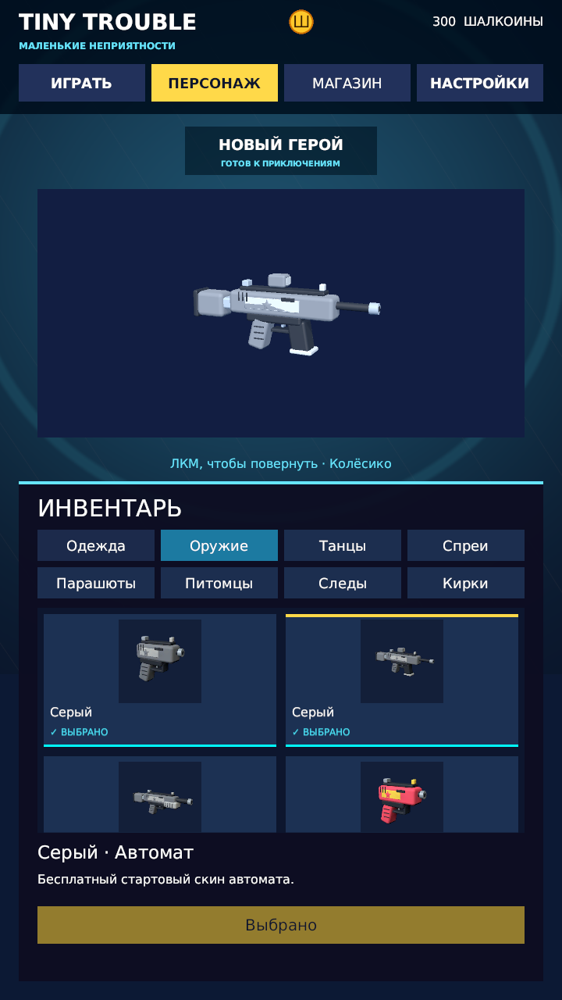
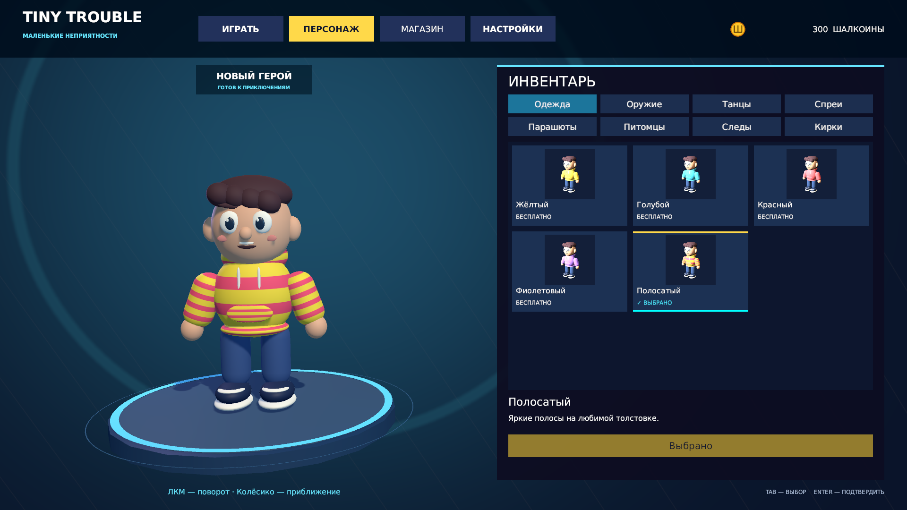
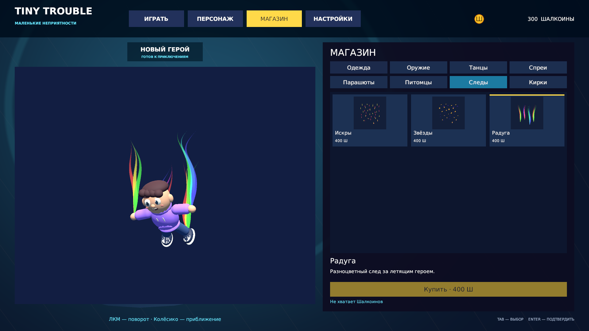

# Tiny Trouble

**Tiny Trouble — «Маленькие неприятности»** — собственная игра на Unity
с мультяшным человечком. Сейчас готово 3D-лобби с магазином и инвентарём.
Герой стоит на подсвеченной платформе, а вокруг него расположены вкладки
и большая кнопка «Играть».


## Что уже готово

- Четыре вкладки: «Играть», «Персонаж», «Магазин», «Настройки».
- Адаптивное меню для горизонтального, вертикального и квадратного окна.
- Дыхание, моргание, приветствие, случайные жесты, взгляд на мышь и реакция на смену одежды.
- Вращение героя левой кнопкой мыши и плавное приближение колёсиком до лица и одежды.
- Четыре бесплатных цвета толстовки, шесть серых стартовых предметов и 27 платных вещей в восьми категориях.
- Примерка, покупка за Шалкоины и отдельное применение в инвентаре.
- Три танца, питомцы рядом с героем, просмотр моделей и анимированных следов падения.
- Детализированное мультяшное снаряжение; предметы вращаются мышью и приближаются колёсиком.
- Собственные спреи с прозрачным фоном и просмотром на образце стены.
- Сохранение покупок, выбранных вещей, цвета и громкости между запусками.
- Управление меню мышью и клавиатурой, поддержка русских надписей.
- Редактируемая сцена и отдельный prefab — сохранённый шаблон персонажа.

## Статус разработки

Проект находится на этапе меню. **Игрового уровня пока нет:** кнопка «Играть»
открывает `SampleScene`, где есть только камера и свет. Для возвращения
остановите Play Mode и снова откройте `Lobby`.

Оружие, спреи, парашюты, следы и кирки можно купить, посмотреть и выбрать
в лобби. Использование в матче, нанесение спреев на стены и пол, движение
питомца за игроком, бои и сетевые матчи ещё предстоит сделать.
Пополнения Шалкоинов пока нет.

Меню проверяется в Unity Editor на 13 размерах, включая 1920×1080,
1024×768, 1024×1024, 720×1280, 390×844 и 844×390. Отдельная сборка,
мобильное устройство, сенсорный ввод и вырезы экрана пока не проверялись.

## Как запустить

Понадобятся Unity Hub, **Unity Editor 2022.3.62f3**, Git и интернет
при первом открытии для загрузки пакетов.

1. Скачайте проект, например:

   ```bash
   git clone https://github.com/denisx555/Tiny-Trouble.git
   ```

2. Добавьте папку с `Assets`, `Packages` и `ProjectSettings` в Unity Hub.
3. Откройте её в Unity 2022.3.62f3 и дождитесь импорта и компиляции.
4. В панели Project откройте `Assets/Scenes/Lobby.unity` двойным щелчком.
5. Нажмите **Play** вверху редактора. Меню появится во вкладке **Game**.

Открывайте только один экземпляр Unity с этим проектом. Если он уже открыт,
используйте существующее окно. Перед перезапуском сохраните изменения,
закройте редактор и дождитесь его завершения.

## Как пользоваться меню

| Элемент | Что делает |
| --- | --- |
| «Играть» | Показывает кнопку перехода в пока пустую `SampleScene`. |
| «Персонаж» | Открывает инвентарь собственных вещей и бесплатных цветов. |
| «Магазин» | Позволяет примерить и купить вещи за Шалкоины. |
| «Настройки» | Сохраняет общую громкость; надпись имеет пробел, например `37 %`. |
| ЛКМ на герое + движение влево / вправо | Поворачивает персонажа на полный круг. |
| Колёсико над героем | Вверх — приблизить, вниз — отдалить. |
| ЛКМ в окне предмета + движение мыши | Поворачивает предмет вслед за движением мыши влево / вправо и вверх / вниз. У спрея угол ограничен, чтобы рисунок оставался виден. |
| Колёсико над предметом | Приближает или отдаляет предмет; новый выбор возвращает общий вид. |
| Колёсико над каталогом | Прокручивает карточки, не приближая героя. |
| Tab / Shift+Tab | Выбирает следующий / предыдущий доступный элемент. |
| Стрелки | Перемещают выделение, на ползунке меняют громкость. |
| Enter | Нажимает выбранную кнопку. |

Поворот остаётся после отпускания мыши. При новом входе герой смотрит вперёд;
поворот и приближение не записываются в профиль. Приближение сохраняется
при смене вкладок и размеров окна; крупным планом ноги могут уходить за экран.
Над кнопками, ползунком и окном предмета колесо не приближает героя.

Герой дышит и моргает, один раз машет при входе, затем делает случайные
жесты с паузами 5–10 секунд. Вдох и выдох занимают 3 секунды: тело немного
поднимается, толстовка расширяется, ступни остаются на платформе.
Применение нового цвета вызывает взгляд вниз и кивок на 1,6 секунды.
Восстановление сохранённой одежды не повторяет эту реакцию.
Вращение прерывает крупные жесты и танец, сохраняя дыхание и моргание.
Плечи находятся внутри туловища, поэтому рука остаётся соединённой при взмахе.

На широком экране герой или предмет слева, каталог справа. На вертикальном
и квадратном экране просмотр сверху, панель снизу. У каталога есть прокрутка;
название, описание и действие закреплены за его пределами.

## Магазин и инвентарь

При первом создании локального профиля выдаются **1000 Шалкоинов**.
Четыре обычных цвета толстовки бесплатны. Сразу выбраны бесплатные серые
пистолет, автомат, дробовик, парашют и кирка; стартовый след «Воздух» состоит
из мягких серых полос. Они доступны в инвентаре с первого запуска и не требуют
покупки. После выбора цветного скина можно вернуться к серому бесплатно.
При загрузке прежнего профиля серые предметы занимают только пустые места;
купленные и выбранные вещи, баланс и цвет одежды сохраняются.

| Категория | Платных вещей | Цена одной, Шалкоины |
| --- | ---: | ---: |
| Одежда | 3 | 400 |
| Скины оружия | 6: по два для пистолета, автомата и дробовика | 350 |
| Танцы | 3 | 500 |
| Спреи | 3 | 300 |
| Парашюты | 3 | 400 |
| Питомцы | 3 | 600 |
| Следы падения | 3 | 400 |
| Скины кирки | 3 | 400 |

1. В магазине выберите категорию и карточку. Одежда примеряется на герое,
   танец воспроизводится на нём, питомец появляется рядом. Остальные предметы
   показываются в отдельном окне; след имеет пример с маленьким героем.
2. «Купить» списывает цену один раз и добавляет вещь в инвентарь.
   Примерка не тратит монеты; покупка сама не надевает вещь.
3. В инвентаре выберите вещь и нажмите «Надеть» / «Выбрать», чтобы сохранить
   применение. Выбранный танец можно повторить отдельной кнопкой.
4. Для каждой категории выбирается одна вещь. Скины пистолета, автомата
   и дробовика занимают отдельные места и не заменяют друг друга.
5. Выход из просмотра возвращает применённую одежду и питомца.
   Смена категории и потеря фокуса окна останавливают танец.

У каждого платного скина оружия собственный силуэт: округлый пистолет
«Конфетти», гранёный «Ледяной», спортивный автомат «Лайм» с изогнутым
магазином, «Галактика» с открытым светящимся ядром, двуствольная «Вспышка»
и морская «Волна» с плавниками и трубками. Детали есть с обеих сторон;
оружие можно вращать и приближать.
Купол парашюта состоит из секций ткани, открыт снизу и соединён со стропами.
У ледяной кирки крупные кристаллы, трещины и зажимы, у неоновой — изогнутое
лезвие, световые дорожки и аккумулятор, у космической — полумесяц,
кольцо вокруг звезды и украшенная рукоять. Описание космической кирки
пользователь написал сам: «Кирка со звёздами для крутости». Радужные ленты,
искры и объёмные звёзды тянутся от рук и обуви героя в позе свободного падения.
Четыре потока идут назад, изгибаются и плавно исчезают; героя можно рассмотреть крупнее.
Просмотр и его поворот не тратят монеты и не меняют сохранённый выбор.






Профиль — JSON версии 1 в PlayerPrefs под ключом `TinyTrouble.Cosmetics.Profile`:
баланс, купленные коды и выбранные вещи. Это локальное сохранение,
без синхронизации между устройствами и защиты от ручного изменения.
Старый цвет переносится без потери громкости. Неизвестные купленные коды
сохраняются, но отсутствующие в каталоге товары не показываются.
При повреждении или неизвестном формате исходная запись сохраняется,
её копия помещается в `TinyTrouble.Cosmetics.Profile.Recovery`, а покупки и запись
выбора отключаются. Повторные 1000 в таком случае не выдаются.
Ошибка записи не считается успешной покупкой или применением.
При первом запуске без прежних настроек выбраны жёлтый цвет и громкость 100%.
Музыка пока не добавлена.

## Устройство проекта

- `Assets/Scenes/Lobby.unity` — готовое лобби; `SampleScene.unity` — пока пустой уровень.
- `Assets/TinyTrouble/Prefabs` — шаблон героя; `Cosmetics` — каталог, модели, рисунки и иконки.
- `Assets/TinyTrouble/Runtime` — управление лобби, раскладка, вращение, приближение и движения героя.
- `Runtime/Cosmetics` — `CosmeticService` проверяет покупки и применение,
  `CosmeticProfileStore` сохраняет профиль, `CosmeticPanel` управляет карточками,
  `CosmeticPanelLayout` раскладывает панель, `CosmeticPreview` показывает вещи,
  `CosmeticPreviewInput` передаёт ему вращение и колесо мыши,
  `CharacterAppearance` меняет одежду, `CharacterDance` запускает общие движения.
- `Assets/TinyTrouble/Editor` — `CosmeticAssetBuilder`, `CosmeticModelBuilder`,
  `CosmeticTextureBuilder`, `CosmeticEquipmentBuilder` (включая файлы
  `CosmeticWeaponBuilder` и `CosmeticPickaxeBuilder`) и `CosmeticMeshBuilder`
  создают собственные ассеты; `CosmeticUIBuilder.Upgrade`
  подключает интерфейс к существующей сцене.
- `Cosmetics/Meshes` — сохранённые сетки объёмных деталей; `Cosmetics/Artwork` —
  собственные рисунки спреев в SVG и готовые PNG, используемые при сборке ассетов.
- `Assets/TinyTrouble/Tests` — проверки в редакторе и во время игры.

Интерфейс использует uGUI — кнопки и панели поверх сцены. Графика использует
Built-in Render Pipeline — встроенный способ рисования Unity.
В Build Settings сцены идут в порядке `Lobby`, затем `SampleScene`.
**Tiny Trouble → Build Lobby** для запуска не требуется: сцена уже сохранена.
Повторное создание может заменить ручные правки сцены и персонажа.

## Инструменты разработки

Версии закреплены в [manifest.json](Packages/manifest.json)
и [packages-lock.json](Packages/packages-lock.json).

| Пакет | Версия | Назначение |
| --- | --- | --- |
| uGUI | 1.0.0 | Интерфейс. |
| Unity Test Framework | 1.1.33 | Автоматические тесты. |
| MCP for Unity | 10.3.0 | Связь помощника с редактором. |
| Cinemachine | 3.1.7 | Инструменты камер. |
| ProBuilder | 5.2.4 | Редактирование геометрии. |
| VFX Graph | 14.0.12 | Визуальные эффекты. |
| glTFast | 6.14.1 | Импорт glTF/GLB. |

Наличие пакета не означает, что лобби использует все его возможности.
Unity MCP нужен для управления редактором помощником; для ручного запуска
игры подключать помощника не требуется.

## Проверка работы

1. Запустите Lobby, переключите четыре вкладки и восемь категорий.
2. Примерьте одежду, купите её, отдельно наденьте в инвентаре.
   Перезапустите Play Mode: баланс, покупка и выбор должны сохраниться.
3. Проверьте бесплатные цвета, громкость 0 / 37 / 100 %, Tab, стрелки и Enter.
4. Посмотрите танцы, питомцев, модели и следы; меняйте категории во время просмотра.
5. Поверните и приблизьте героя и предметы; прокрутите каталог в вертикальном окне.
   Проверьте серое снаряжение в инвентаре: при его применении баланс не уменьшается.
6. Измените Game View на горизонтальный, вертикальный и квадратный размер.
7. Нажмите «Играть»: открывается SampleScene без ошибок в Console.

Для автоматических тестов сохраните сцены, выйдите из Play Mode и откройте
**Window → General → Test Runner**. Запустите **Run All** отдельно в EditMode
и PlayMode. Проверяются данные, запись и её ошибки, сцена, покупка и применение,
просмотр, раскладка, клавиатура и прежние движения/управление героем.
Временные профиль, резерв, цвет, громкость и размеры Game View восстанавливаются
после проверок. Последний полный прогон: **51/51 EditMode и 79/79 PlayMode**.
Фактические итоги последнего запуска — в
[отчёте новых моделей снаряжения](docs/superpowers/reports/2026-10-11-themed-equipment-validation.md).
Прежний результат **21/21 EditMode и 56/56 PlayMode** сохранён в
[отчёте приближения](docs/superpowers/reports/2026-10-10-zoom-validation.md).

## Документация и правила работы

- [Спецификация магазина](docs/superpowers/specs/2026-10-11-shop-inventory-design.md).
- [План магазина](docs/superpowers/plans/2026-10-11-shop-inventory.md).
- [Описание лобби](docs/superpowers/specs/2026-10-10-lobby-design.md).
- [Живой персонаж](docs/superpowers/specs/2026-10-10-character-life-design.md).
- [Проверка живого героя](docs/superpowers/reports/2026-10-10-character-life-validation.md).
- [Исправление плеча](docs/superpowers/reports/2026-10-10-shoulder-validation.md).
- [Заметность дыхания](docs/superpowers/reports/2026-10-10-breathing-validation.md).
- [Приближение колёсиком](docs/superpowers/reports/2026-10-10-zoom-validation.md).
- [AGENTS.md](AGENTS.md) — правила помощника и обучения.

Снимки выше сделаны в Unity. HTML-макеты из `docs` использовались для согласования
дизайна; они не заменяют проверку игровой сцены.
Комментарии C# пишутся по-русски: XML перед объявлениями, обычные `//` и
`/* ... */` только внутри методов и свойств. Коммиты также пишутся по-русски.
Сохраняйте `.meta` вместе с ассетами: по ним Unity связывает объекты проекта.
`Library`, `Temp`, `Logs` и локальные настройки исключены через [.gitignore](.gitignore).
У DejaVu есть [лицензия](Assets/TinyTrouble/UI/Fonts/LICENSE.txt).
