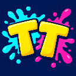

# Иконка Tiny Trouble

Выбранный пользователем вариант: буквы **TT** с брызгами краски.
Изображение создано встроенным инструментом imagegen 11 октября 2026 года.

Исходник: `Assets/TinyTrouble/Branding/TinyTroubleIcon.png`, 1254×1254 PNG.
Unity импортирует его как обычную текстуру 1024×1024, без сжатия и уменьшенных
копий для удалённых объектов (mipmaps). Фон непрозрачный; углы не вырезаны,
чтобы форму иконки могла задавать операционная система.

Иконка назначается в **Edit → Project Settings → Player → Default Icon**.
Она предназначена для значка приложения после сборки. Эмблема внутри лобби
остаётся текстовой. Отдельные варианты Android Adaptive Icon не готовились.

## Промпт

```text
Use case: logo-brand. Asset type: finished square application icon for original cartoon Unity game Tiny Trouble, 1024 by 1024 pixels. Create ONE clean, polished, playful icon image, not a mockup. The only text is exactly "TT", two unmistakable uppercase Latin T letters next to each other, very large chunky yellow lettering with a modest dark navy bevel/shadow and clear separation, both crossbars fully visible. Dark midnight blue full-bleed square background, rich turquoise and hot pink paint splashes behind the letters, a few purposeful oversized paint drops. Rounded playful lettering edges, vibrant cartoon game style, crisp high-contrast silhouette, simple enough to recognize at 32 pixels. Letter mark occupies central 65 percent width and 58 percent height, ample safe margin from all borders, tasteful slight dynamic tilt without harming legibility. Paint splashes frame rather than cover the letters. No character, weapons, game screenshot, additional words, badges, borders, device frame, white margins, baked rounded corners, watermark, texture noise, or tiny decorative details. Opaque background all the way to the image edges.
```


## Проверка

В открытом Unity Editor проверены: Default Icon ссылается на новую текстуру,
импортированный размер — 1024×1024, сжатие выключено, mipmaps выключены.
Сцена не изменена; на момент проверки назначения ошибок Console не было.
Временный C#-файл настройки удалён. При завершающем Refresh редактор
аварийно завершился с SIGSEGV в нативном коде. Настройка и файлы сохранились;
проект после завершения процесса повторно открыт без временного скрипта.
Уменьшенные изображения получены из импортированной текстуры в Unity;
буквы TT читаются на 32 и 128 пикселях. Отдельная сборка приложения не запускалась.



