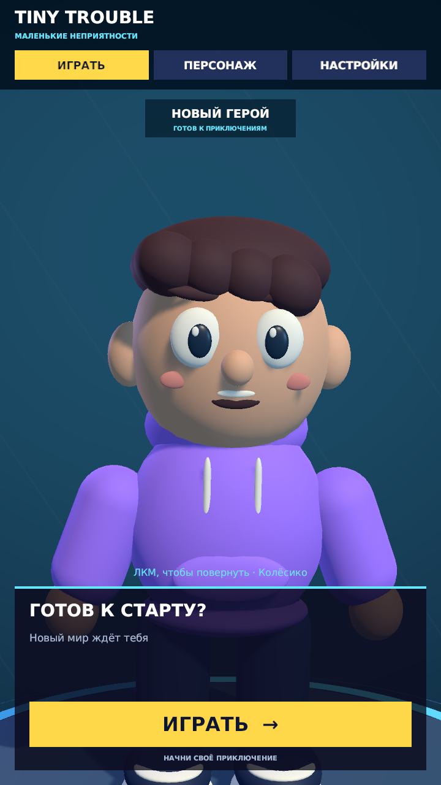

# Проверка приближения героя колёсиком

Дата: 10 октября 2026 года. Unity 2022.3.62f3, сцена `Lobby`.

## Реализованное поведение

Колёсико над моделью плавно приближает и отдаляет камеру. При крупном плане
камера направляется выше, на лицо и грудь; нижняя часть тела может уходить
за экран или под панель. Элементы меню сохраняют свой размер.
Приближение ограничено с учётом модели и свободного места для головы.

Прокрутка над кнопками и ползунком не двигает камеру. Выбранное приближение
сохраняется при смене вкладок и размера окна; новая сцена лобби возвращает
обычный вид. Вращение, дыхание, моргание и жесты продолжают работать.

`CharacterDrag` принимает событие прокрутки через существующую систему
попаданий мыши. `LobbyLayout` хранит приближение, плавно двигает камеру
и подбирает расстояние при изменении окна. Новые компоненты, изменения
сохранённой сцены и пересоздание шаблона героя не потребовались.

## Автоматические проверки

| Запуск | Результат | Что проверено |
| --- | --- | --- |
| `40c654cf631b46869691e7e04e0d9c0c` | 1/4, три ожидаемых падения | До реализации камера не реагировала на колёсико. |
| `81fa90e3e7894348bf5c80fdb5969892` | 0/2 | Дополнительные проверки воспроизвели перекрытие волос плашкой и обрезанную подсказку. |
| `40b83a45082845a584c1a8d242f85473` | **56/56 PlayMode** | Полный набор после исправлений и учебной правки скорости. |
| `8ca734d43357435a81785b67280b581e` | **21/21 EditMode** | Сохранённые сцена, ссылки, модель, границы поз и настройки. |
| `5f376cdcf5b841d48915a6cf92b3c9ef` | **1/1 PlayMode** | Усиленный после обзора тест изменения размера и четырёх настоящих поворотов модели. |
| `157c3a47ab4d4ec3a9089a0320da8775` | **56/56 PlayMode** | Полный повторный запуск перед коммитом, включая исправленный тест поворотов. |
| `a1db3d99019a4ca284a047c780ac8265` | **21/21 EditMode** | Повторная проверка сохранённых сцены и ассетов перед коммитом. |

В тесте крупного плана проверены размеры 1920×1080, 1024×1024, 390×844 и 720×1280
при углах 0°, 90°, 180° и 270°. Обзор выявил, что прежний вызов `Turn` только
запоминал угол при отключённом покачивании. Тест исправлен: теперь он действительно
поворачивает модель перед проверкой видимости головы и обработки мыши.
Рабочий код после полного набора тестов не менялся.

Проверки приближения используют настоящую сцену, поиск первого попадания мыши
через `EventSystem`, события прокрутки и положение камеры. Проверены плавный
переход в обе стороны, увеличение головы более чем вдвое, оба предела расстояния,
положение камеры снаружи модели, отсутствие перекрытия головы плашкой,
прокрутка над интерфейсом, вкладки и повторный вход в лобби.

## Визуальная проверка

В обычном режиме игры осмотрен предельный крупный план в 1920×1080 и 720×1280.
Лицо и волосы видны полностью, плашка имени находится выше головы,
подсказка прокрутки помещается в свою область. На широком экране ноги
уходят за нижний край; в вертикальном формате нижняя часть тела оказывается
за панелью. Это соответствует выбранному варианту крупного плана.

## Учебная правка и состояние проекта

Пользователь самостоятельно изменил `ZoomStep` в `CharacterDrag.cs`
с `.08f` на `.16f`. Сохранённое значение и загруженный код проверены:
скорость за шаг колёсика удвоена. Итоговые тесты используют эту правку.

Русские XML-комментарии в четырёх изменённых файлах C# проверены через
синтаксический разбор Roslyn. Обычные комментарии находятся только внутри
методов. `git diff --check` проходит.

Один повторный запуск усиленного теста не начался из-за ожидания компиляции.
Редактор был сохранён и закрыт; новый экземпляр открыт только после фактического
завершения прежнего процесса. После перезапуска код скомпилировался и тест прошёл.
Временная настройка Test Runner `enterPlayModeOptionsEnabled` возвращена
в исходное состояние; временные размеры Game View удалены.
При окончательном осмотре в консоли нет ошибок и предупреждений.
После повторных прогонов перед коммитом появился служебный сигнал Unity MCP
о переподключении WebSocket при обновлении кода. Оба набора тестов завершились
успешно, связь с редактором работает; временные настройки снова восстановлены.

## Границы проверки

Проверено поведение событий колёсика и живой сцены в редакторе. Физическое
колёсико устройства, отдельная сборка, мобильное устройство и сенсорное
приближение не проверялись.
