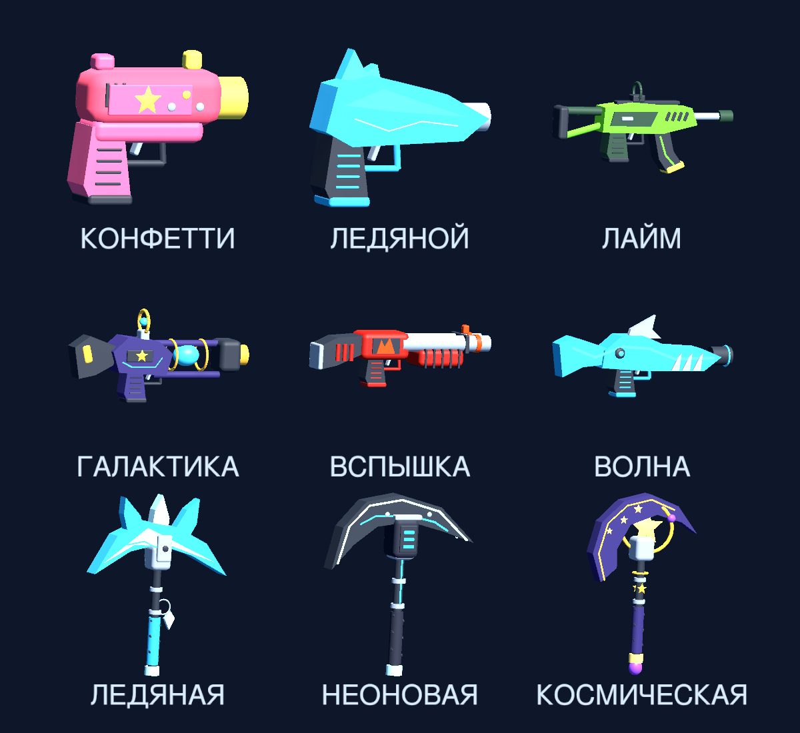
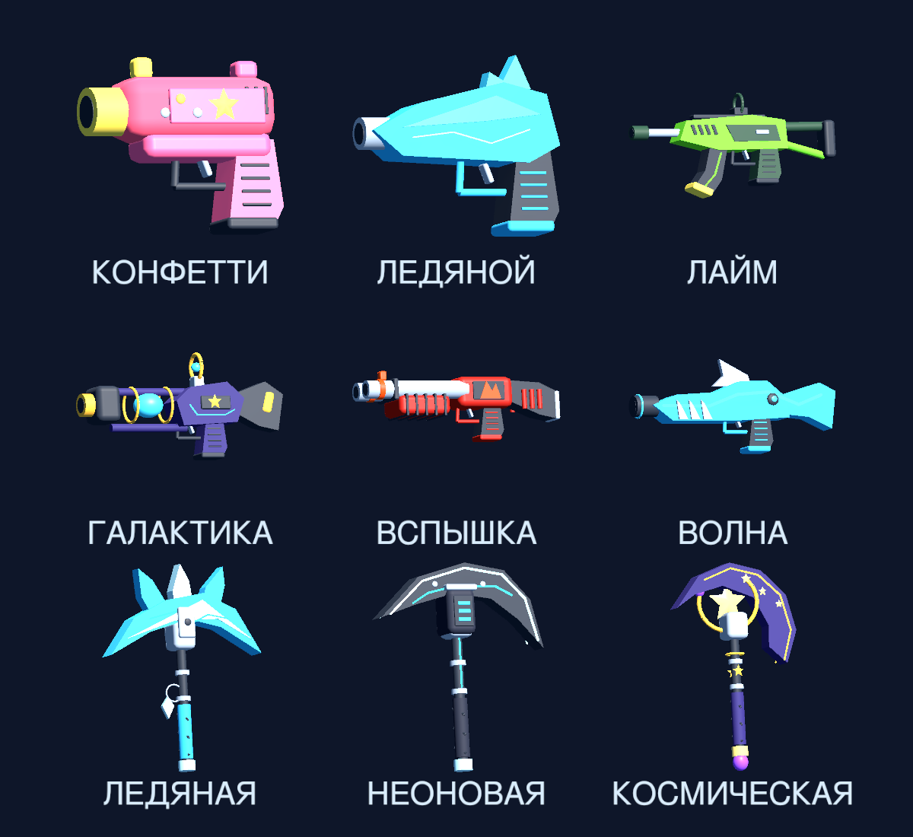
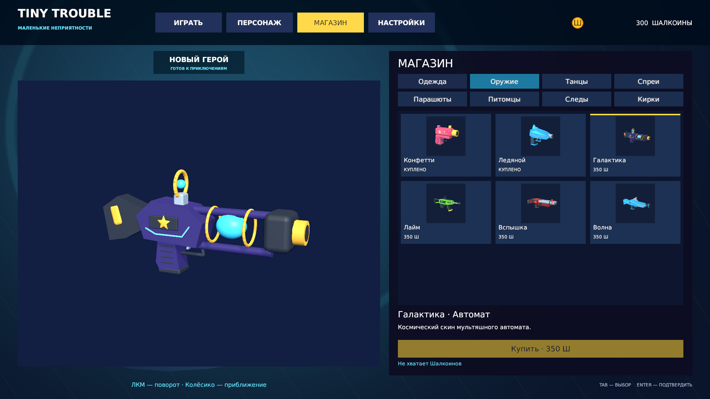
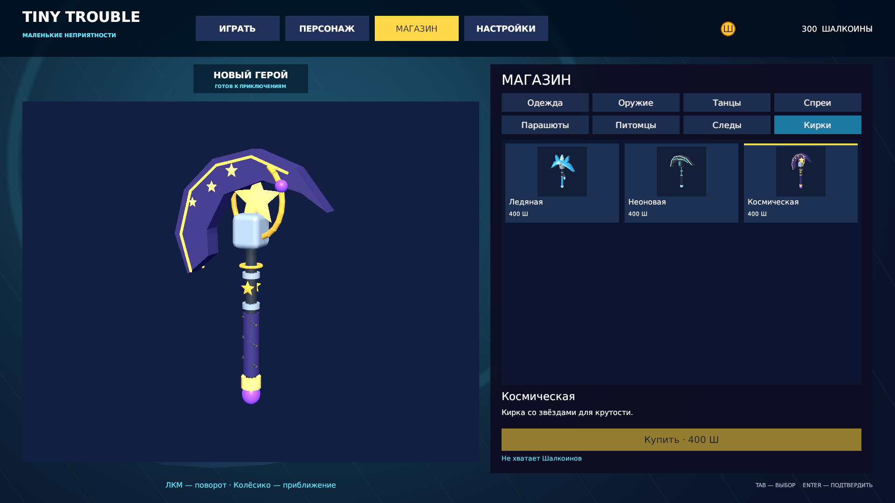
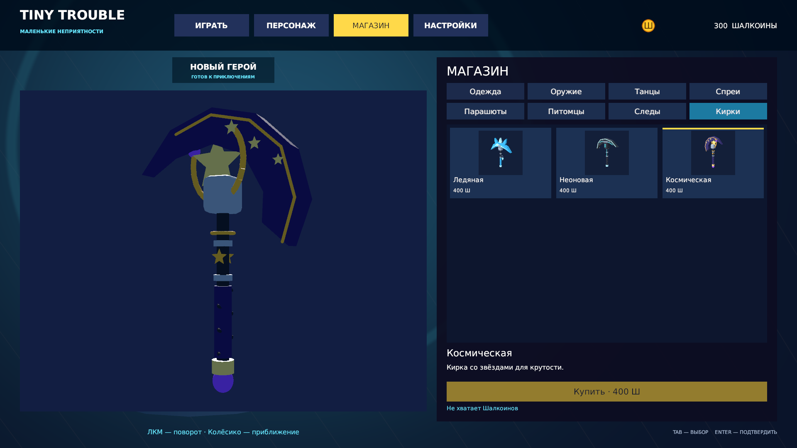
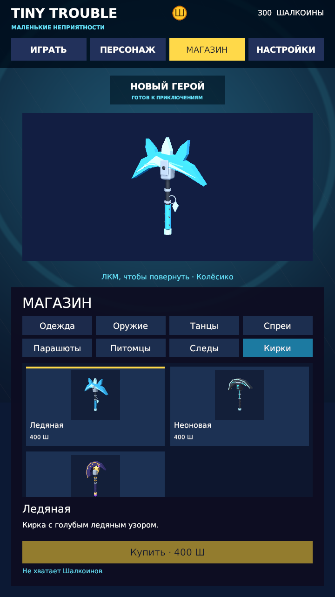

# Разные формы оружия и подробные кирки

Дата: 11 октября 2026 года. Unity Editor 2022.3.62f3, Linux.

## Результат

Все шесть платных скинов оружия получили собственные силуэты. Пистолеты:
округлый «Конфетти» и гранёный «Ледяной». Автоматы: спортивный «Лайм»
с изогнутым магазином и «Галактика» с открытым светящимся реактором.
Дробовики: двуствольная «Вспышка» и морская «Волна» с плавниками и трубками.

Ледяная кирка получила крупные кристаллы, трещины, зажимы и подвеску;
неоновая — изогнутое лезвие, световые дорожки и аккумулятор;
космическая — полумесяц, золотую орбиту и звёздное ядро.
Детали нанесены на обе стороны. Серые вещи сохранены;
серая кирка дополнена обратной вставкой и креплениями.

Цены, идентификаторы товаров, баланс, покупки и сохранённый выбор
не менялись. Управление просмотром используется прежнее.
Внешние игровые модели и новые зависимости не добавлялись.

## Автоматические проверки

- Силуэты трёх пар оружия сравниваются по настоящим треугольникам без материалов.
  До реализации все три теста провалились: отличие составляло 0.
  После реализации все три прошли: отличие больше 12 % площади объединения.
  Это проверка разнообразия форм, а не оценка красоты модели.
- Найдено и воспроизведено неправильное изображение после смены топологии
  сохранённой сетки: простое CopySerialized оставляло прежние данные для рендера.
  Тест сначала получил 51 видимую точку вместо 1688; после явного обновления
  точек, нормалей, координат рисунка и треугольников изображение совпало.
  Объект ассета сохраняется, поэтому ссылки и GUID не заменяются.
- Полный EditMode: **51/51**, 38,15 секунды,
  job `0f98d79fb2f044c7a9799b9c7900f47f`.
- Полный PlayMode: **79/79**, 46,59 секунды,
  job `86bdb22517a64a99a79800f0b4382fdf`.

Проверки охватывают прежние покупки, сохранение профиля и восстановление
после тестов, ссылки каталога, сохранение GUID, исходного шаблона героя,
вращение и приближение, анимации, раскладку и навигацию.

## Просмотр в редакторе

В Unity сняты все девять моделей спереди и сзади, обновлённые карточки,
магазин 1920×1080 и вертикальное окно 720×1280. Проверены космический
автомат, кирки, поворот космической кирки на 180 градусов и приближение.
На общем виде предмет помещается в свою область. На вертикальном экране
каталог прокручивается, описание и кнопка остаются доступны.

Временные размеры Game View удалены, исходный размер восстановлен.
Профиль до и после ручного просмотра совпадает; покупки не совершались.
Ошибок Console нет. Сцена и исходный шаблон героя не переписывались.
Unity оставлен в Play Mode с открытым просмотром космической кирки.

## Учебный шаг

Пользователь самостоятельно изменил Description космической кирки
в CosmeticAssetBuilder.cs на «Кирка со звёздами для крутости».
Сохранённый файл перечитан, каталог и карточки обновлены.

## Проверка кода

Независимый reviewer проверил новые сборщики, сохранение сеток и тесты.
Проверены 21 контур и ссылки девяти шаблонов на сохранённые сетки.
Подтверждённых критических и важных проблем не найдено.

## Ограничения

Это косметические модели для магазина и инвентаря. Бои, использование кирки
в матче и отдельная сборка игры в этой задаче не проверялись.
