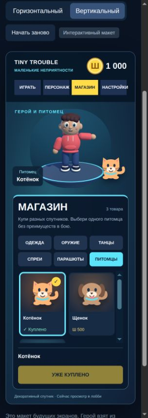
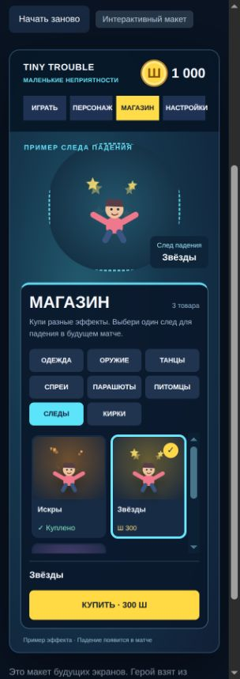

# Магазин и инвентарь Tiny Trouble

Дата: 11 октября 2026 года.

## Цель и границы версии

Перенести согласованный браузерный макет в существующее лобби Unity:
покупать косметические вещи за Шалкоины, хранить коллекцию, выбирать внешний
вид и смотреть результат до покупки. Интерфейс работает в горизонтальном,
вертикальном и квадратном окне без наложения элементов.

Это новый подсистемный функционал поверх нынешнего лобби. Текущий проект
использует Unity 2022.3.62f3, uGUI, Built-in Render Pipeline, простую модель
героя и процедурные жесты. Сохраняем эти инструменты и внешний стиль.

В этой версии реализуем все восемь категорий в магазине и инвентаре.
Матч, стрельба, добыча ресурсов киркой, полёт, нанесение спреев на поверхности
и следование питомца за игроком на уровне остаются будущими задачами.
Питомцы декоративные; косметика не меняет характеристики оружия или героя.
Кнопка «Играть» по-прежнему открывает нынешнюю SampleScene.

## Согласованный каталог

| Категория | Товары | Цена каждого, Шалкоины |
| --- | --- | ---: |
| Одежда | Полосатый, Космос, Неон | 300 |
| Оружие: пистолет | Конфетти, Ледяной | 250 |
| Оружие: автомат | Галактика, Лайм | 250 |
| Оружие: дробовик | Вспышка, Волна | 250 |
| Танцы | Робот, Пружинка, Победный | 400 |
| Спреи | Улыбка, Шалун, Бум! | 200 |
| Парашюты | Облака, Космос, Неон | 300 |
| Питомцы | Котёнок, Щенок, Роботик | 500 |
| Следы падения | Искры, Звёзды, Радуга | 300 |
| Скины кирки | Ледяная, Неоновая, Космическая | 300 |

Всего 27 платных товаров. Четыре нынешних цвета толстовки — жёлтый,
голубой, красный и фиолетовый — доступны бесплатно в инвентаре одежды.
Совпадающие названия разных категорий имеют разные постоянные идентификаторы.
Скины оружия относятся только к указанному типу оружия.

Сохраняем написанные пользователем описания:

- «Бум!»: «Оставь яркий след в матче.»
- «Щенок»: «Супер друг для красоты.»

Время одного цикла движения частиц следа — 2,4 секунды, как в проверенной
учебной правке макета. Будущие товары добавляются в каталог без переписывания
покупок и правил выбора.

## Вкладки и раскладка

- Вверху четыре вкладки: «Играть», «Персонаж», «Магазин», «Настройки».
- «Персонаж» открывает инвентарь; «Магазин» показывает весь платный каталог.
- Баланс обозначается круглой золотой монетой с буквой «Ш» и числом.
  Название валюты — «Шалкоины»; начальный запас — 1000.
- В каталоге восемь кнопок категорий: «Одежда», «Оружие», «Танцы», «Спреи»,
  «Парашюты», «Питомцы», «Следы», «Кирки». Заголовки просмотра поясняют полное
  название «Следы падения» и «Скины кирки».
- Карточка содержит картинку, название, тип оружия при необходимости,
  цену или отметку покупки/активного выбора. Выделение просмотренной карточки
  отличается от отметки действительно выбранной вещи.
- Список товаров прокручивается внутри панели. Описание и большая кнопка
  покупки/выбора находятся вне списка и остаются видимыми.
- Широкий экран: просмотр слева, каталог справа; рекламное описание старого
  лобби скрывается на вкладках магазина и инвентаря, освобождая место.
- Вертикальный и квадратный экран: просмотр над каталогом. Категории
  располагаются в несколько рядов с читаемыми названиями; карточки переходят
  с трёх столбцов на два при недостатке ширины. Длинные дополнительные
  пояснения можно скрывать, но название, цена, выбранная вещь и действие видимы.
- У 4:3 и промежуточного горизонтального окна просмотр и каталог занимают
  отдельные области; вкладки при необходимости переходят под название игры.
- Вращение и приближение героя, мышь, Tab/Shift+Tab, стрелки и Enter сохраняются.
  Скрытые, заблокированные и купленные кнопки действий не получают фокус.
  Клавиатурный переход к карточке прокручивает список, чтобы её было видно.
  Прокрутка над каталогом не приближает героя; после обновления карточек
  выделение переводится на существующий доступный элемент.

Согласованный вид показан на снимках браузерного макета; это иллюстрации
дизайна, а не снимки уже реализованного магазина Unity.

## Покупки и владение

1. При создании первого профиля выдаём 1000 Шалкоинов один раз. Бесплатные
   цвета уже доступны. Платных вещей ещё нет: примерные покупки браузерного
   макета не переносятся в игру.
2. Нажатие карточки меняет только временный просмотр. Оно не списывает деньги,
   не покупает вещь и не меняет сохранённый выбор.
3. Кнопка «Купить» повторно проверяет идентификатор, цену из каталога,
   владение, баланс и отсутствие уже выполняющейся операции.
4. Для допустимой покупки готовится новая копия профиля: цена вычитается,
   идентификатор добавляется в коллекцию. Сохранение проходит до публикации
   нового состояния интерфейсу. Покупка сама не надевает вещь.
5. После успешного сохранения обновляются баланс и отметка «Куплено»;
   вещь доступна в инвентаре. Двойное или быстрое повторное нажатие не
   списывает деньги второй раз.
6. Купленный товар нельзя купить снова. При нехватке монет действие
   заблокировано и показывает понятную надпись. Баланс не становится отрицательным.
7. При ошибке сохранения прежние баланс, владение и выбор остаются активными;
   выводится сообщение с предложением повторить действие.

Покупки за реальные деньги, награды, пополнение валюты, возвраты и серверная
экономика в эту версию не входят.

## Выбор в инвентаре

Инвентарь показывает только бесплатные и купленные вещи соответствующей
категории. Пустая категория поясняет, что вещи можно приобрести в магазине.
Нельзя применить неизвестную или некупленную вещь через вызов метода.

Одновременно сохраняется один выбор для каждого независимого места:

- одежда;
- скин пистолета;
- скин автомата;
- скин дробовика;
- танец;
- спрей;
- парашют;
- питомец;
- след падения;
- скин кирки.

Например, замена «Ледяного» пистолета на «Конфетти» оставляет прежний скин
автомата и дробовика. Обе купленные окраски пистолета остаются в коллекции.
Замена следа не меняет питомца, парашют или кирку.

Кнопки называются по действию: «Надеть», «Выбрать спрей», «Выбрать парашют»,
«Выбрать питомца», «Выбрать след», «Выбрать скин», «Выбрать и танцевать».
Уже активная вещь отмечается и не сохраняется повторно. Выбранный танец можно
проиграть снова. Для отсутствующих платных выборов используются базовый
внешний вид оружия, парашюта и кирки; питомец, след, спрей и танец ещё не выбраны.

При выходе из просмотра, смене категории, вкладки или переходе на уровень
временный вид убирается и восстанавливается сохранённый выбор. Поворот и
приближение героя сохраняются при смене вкладок, как в нынешнем лобби.

## Просмотр и графика Unity

Создаём собственные мультяшные материалы, картинки и простые модели в стиле
Tiny Trouble. Согласованный макет задаёт расположение и смысл интерфейса;
готовые материалы, модели, логотипы и анимации Fortnite не нужны.

- Одежда: реальные полосы, звёзды и неоновые линии на нынешней толстовке.
  Бесплатные цвета работают по-прежнему. Просмотр не сохраняет цвет и не
  запускает реакцию на каждую карточку; применение другой одежды вызывает
  одну реакцию героя.
- Оружие и кирки: отдельный крупный просмотр простых объёмных моделей с
  выбранным материалом. Для оружия виден конкретный тип; боевая функциональность
  пока не добавляется.
- Парашюты: раскрытый купол, стропы и соответствующий узор в крупном просмотре.
- Спреи: крупный рисунок на нейтральной поверхности просмотра; нанесения на
  стены и пол сцены матча в этой версии нет.
- Питомцы: котёнок, щенок и робот рядом с героем на платформе. После применения
  выбранный спутник виден и на вкладке «Играть». Временный просмотр другого
  питомца возвращается к сохранённому при выходе.
- Следы: отдельный пример падения с маленьким героем и частицами/цветными
  лентами. Скорость цикла — 2,4 секунды. Герой лобби не падает с платформы.
- Танцы: «Робот» — угловатые движения рук, «Пружинка» — пружинистые движения,
  «Победный» — праздничные движения рук и тела. Это разные короткие
  процедурные анимации нынешнего героя, которые повторяются только в просмотре.

Крупный просмотр предметов отделён от реального героя, чтобы не менять
его позу, угол, масштаб или материалы навсегда. Используется отдельный корень
предпросмотра и камера с RenderTexture — изображением камеры внутри панели.
Картинки карточек сохраняются редактором как ассеты; новый набор объектов
не создаётся и не уничтожается каждый кадр. Материалы и RenderTexture
освобождаются при закрытии лобби.

Дыхание и моргание героя продолжаются во время танца. Танец занимает место
крупного жеста: приветствие и случайные жесты не спорят с ним. Вращение,
смена вкладки/категории и потеря фокуса плавно завершают просмотр танца.
После него возвращается обычное ожидание. Применение другой одежды во время
танца прекращает танец и запускает реакцию на одежду. Только один компонент
записывает позу каждого сустава; новые границы танцев учитываются камерой
вместе с нынешними жестами. Питомец не перекрывает героя и интерфейс.

## Данные и сохранение

Рекомендуем отдельный каталог ScriptableObject — редактируемый ассет Unity,
хранящий определения товаров. Это удобнее большого списка условий в
LobbyController; JSON-каталог тоже возможен, но хуже связывает модели и картинки
с объектами Unity. Серверный каталог пока избыточен для локального лобби.

Определение товара содержит постоянный строковый идентификатор, категорию,
название, описание, цену, тип оружия при необходимости, картинку и ссылки
на материалы, модель или параметры анимации. Порядок карточек задан каталогом.
Идентификаторы согласованного HTML-каталога сохраняются, включая `trail-*`,
`pickaxe-*`, `pet-*` и бесплатные `base-*`. Удаление или перестановка карточки
не меняет идентичность уже купленного товара.

Профиль содержит версию формата, целый баланс, множество купленных
идентификаторов и перечисленные независимые выборы. Храним его одним JSON
документом под отдельным ключом `TinyTrouble.Cosmetics.Profile` в PlayerPrefs,
за интерфейсом хранилища. PlayerPrefs уже используется проектом; объём малого
локального профиля подходит для этого этапа. Защита от ручного редактирования
и синхронизация с сервером пока не предусмотрены.

Сохранение — единая операция для баланса, владения и выбора. При исключении
возвращаем предыдущую строку/отсутствие ключа в памяти PlayerPrefs и не
публикуем изменённый профиль. Это согласованность действия приложения,
а не обещание защиты от повреждения диска или потери питания.

Если ключ отсутствует, создаём первый профиль и выдаём стартовый запас.
Прежний цвет из LobbyPreferences становится начальной бесплатной одеждой;
громкость не меняется. После создания источником выбора одежды служит профиль.
При выборе бесплатного цвета обновляем также прежний ключ цвета для
совместимости существующего API; при ошибке сохранения восстанавливаем его.
Платный скин хранится по идентификатору и имеет приоритет над прежним цветом.

Проверяем формат и значения при загрузке: отрицательный баланс приводится
к нулю, дубликаты покупок убираются, выбранная вещь обязана быть известной,
купленной/бесплатной и подходить своему месту. Недопустимый выбор заменяется
бесплатной одеждой либо базовым/пустым выбором. Неизвестные купленные
идентификаторы сохраняются в профиле, но не рисуются в текущем каталоге.

Повреждённый JSON или неизвестная версия не считаются первым запуском:
1000 повторно не выдаются. Исходную строку сохраняем в отдельном ключе
восстановления, покупки и сохранение выбора блокируем, показываем понятное сообщение и не
перезаписываем повреждённый профиль. Остальное лобби остаётся доступным.
Тесты используют временное/подставное хранилище и восстанавливают прежние
PlayerPrefs, чтобы не менять коллекцию пользователя.

## Компоненты и интеграция

Границы новых компонентов:

- `CosmeticCatalog` / `CosmeticItem`: определения ассетов и поиск по идентификатору.
- `CosmeticProfile`: данные баланса, владения и выбора, без объектов сцены.
- `CosmeticProfileStore`: чтение/проверка/сохранение профиля через небольшой интерфейс.
- `CosmeticService`: проверки покупки и выбора, новая копия состояния и уведомление
  об успешном действии. Не зависит от кнопок или камеры.
- `CosmeticPanel`: категории, карточки, прокрутка, выделение и действия для
  двух режимов — магазин/инвентарь.
- `CharacterAppearance`: единственный владелец материалов одежды и применения
  внешнего вида; нынешний ApplyColor делегирует ему работу.
- `CosmeticPreview`: временный вид, отдельные предметы и восстановление
  применённого выбора; не сохраняет профиль.
- `CharacterDance`: состояние просмотра танца, передающее позу нынешним
  CharacterLife/CharacterGestures, без второго независимого писателя суставов.
- `CosmeticAssetBuilder` и `CosmeticUIBuilder`: создание каталога, картинок,
  моделей и сохранённых UI-объектов в редакторе. Отделяют новый код от уже
  крупного LobbySceneBuilder.

Изменяем только нужные точки существующего кода: LobbyController знает
четыре вкладки и первый доступный элемент панели, а SetHoodieColor делегирует
выбор бесплатной одежды. LobbyLayout выделяет увеличенную область каталога,
учитывает баланс/четвёртую вкладку и область питомца. CharacterLife и
CharacterGestures согласуют танцы с нынешними движениями. Существующая сцена
Lobby и prefab героя обновляются с сохранением связей и файлов `.meta`.
Новая структура повторно создаётся инструментом редактора воспроизводимо.

Новые зависимости и сторонний игровой контент не требуются. Перед работой
в Unity используем уже открытый редактор через MCP; второй экземпляр проекта
не запускаем. Не запускаем полную пересборку сцены, не проверив ручные изменения.

## Проверки и критерии готовности

EditMode:

- уникальные идентификаторы, 27 платных товаров, 4 бесплатных цвета,
  цены, типы оружия и обязательные ссылки сохранённого каталога;
- первый профиль получает 1000 один раз, старый цвет переносится, громкость
  сохраняется; повторное чтение не пополняет баланс;
- покупка, повторное нажатие, нехватка денег, несуществующий товар и ошибка
  записи не нарушают баланс/владение;
- независимый выбор каждого оружия и остальных мест, запрет некупленного
  выбора, сохранение коллекции после замены;
- перезагрузка профиля, повреждённый JSON/версия, дубликаты и неверные выборы;
- сохранённые сцена, ссылки UI, prefab и границы новых поз.

PlayMode и просмотр редактора:

- покупка настоящими кнопками, отметка в инвентаре, применение и восстановление
  после повторного запуска; никакого переноса примерных покупок из HTML;
- просмотр не тратит деньги и не сохраняет выбор; выход возвращает применённый
  вид, а быстрое переключение не оставляет старые модели и эффекты;
- видимые узоры одежды/оружия/кирки, разные питомцы/спреи/парашюты,
  все три танца и следа; в Unity проверяется движение, а не только надпись;
- сохранность дыхания, моргания, плеча, вращения, приближения, громкости и
  перехода в SampleScene; танец уступает вращению и реакции на одежду;
- все четыре вкладки и восемь категорий на прежних 13 размерах, включая
  1920×1080, 1280×720, 1024×768, 1024×1024, 720×1280, 390×844 и 844×390;
  отсутствие пересечений шапки, области героя/питомца, каталога и кнопки;
- прокрутка карточек мышью и клавиатурой, отсутствие скрытого фокуса,
  корректная прокрутка колёсиком над UI, действия Enter и Shift+Tab;
- в Console нет новых ошибок; повторное открытие/выход освобождают временные
  материалы и камеры предпросмотра.

После изменения игровых файлов запускаем нужные новые тесты, затем полный
EditMode и PlayMode для регрессий. Результаты и новые снимки реальной игры
попадают в отчёт и README. Старые 21/21 и 56/56 — сведения о прежней версии,
а не доказательство готовности магазина.

## Обучение и следующие шаги

Учебные правки браузерного макета проверены: описания «Бум!»/щенка и время
следа 2,4 секунды. При реализации Unity нужен отдельный маленький шаг в C#:
перед настройкой конкретного товара открыть нужное место в VS Code, предложить
пользователю изменить одну понятную величину/подпись, оставить её нетронутой
до его попытки и проверить сохранённый результат. Конкретный файл и шаг
фиксируются в плане реализации.

Комментарии нового и изменённого C# — простые русские XML-комментарии перед
объявлениями. Обычные и блочные комментарии разрешены только в методах
и свойствах. Коммиты пишутся по-русски; README обновляется вместе с функцией.

Сейчас согласован макет и подготовлена эта спецификация. Следующий этап —
проверка пользователем этого документа, затем письменный план реализации
и выбор способа его выполнения. Игровой код магазина ещё не изменён.
